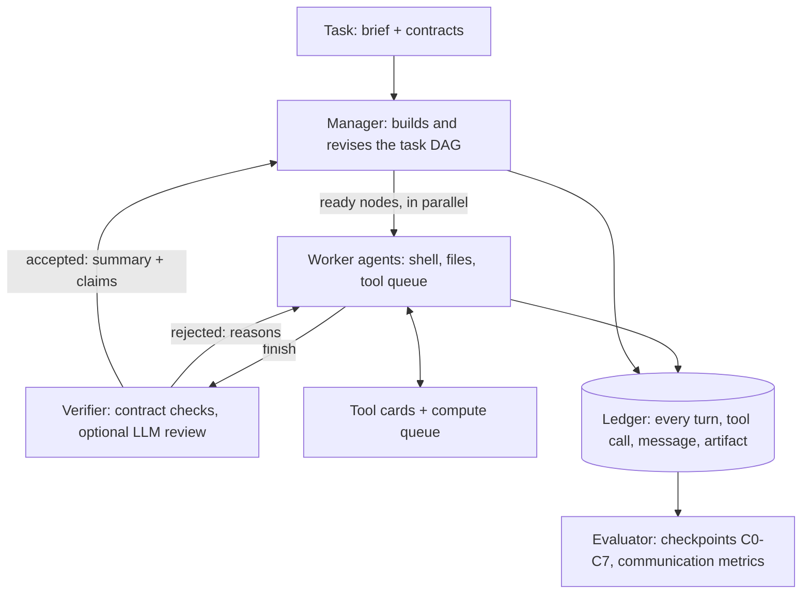

# MATHBAC reproduction agents

A multi-agent system that reproduces computational science papers, built for the DARPA MATHBAC project (CMU + USC). The first test is reproducing Cha et al., "Unifying structural descriptors for biological and bioinspired nanoscale complexes" (*Nat. Comput. Sci.* 2022), with checkpoints that score how far the system gets.

The design follows the 11/3 meeting notes and the design doc: MACU's manager and task graph, with command-line workers in containers instead of VMs; the methods from Jessica Ma's PPI2PNI sheet as tools with instruction cards; one model gateway (Claude, OpenRouter, OpenAI); and an evaluator that recomputes every result from files and measures communication between agents.

## How it works



- **Manager** (`mathbac/agents/manager.py`). In `reference` mode it runs the task's reference graph. In `llm` mode an LLM manager adds, rewrites and cancels nodes with tools, never seeing the reference graph.
- **Workers** (`mathbac/agents/worker.py`). One tool-calling loop per node with `read_file`, `write_file`, `list_dir`, `run_shell`, `list_tools`, `read_tool_card`, `run_tool`, `job_status` and `finish`. Role prompts are in `mathbac/agents/prompts/`. In `dynamic` role mode the manager writes them instead.
- **Verifier** (`mathbac/agents/verifier.py`). When a worker calls `finish`, the node's acceptance check runs on its files. Failures go back to the worker with reasons.
- **Sandbox** (`mathbac/sandbox.py`). One Docker container per run. It sees only the workspace (`/work`) and the materials for the access level (`/materials`, read-only). API keys are never passed in.
- **Compute queue** (`mathbac/compute/queue.py`). Heavy tool runs are queued and cached by tool, arguments and input-file contents. Backends: local thread pool, or Slurm + Apptainer.
- **Gateway** (`mathbac/gateway/`). Claude through the Anthropic SDK (adaptive thinking, effort, prompt caching, server-side refusal fallback); OpenRouter and OpenAI through an OpenAI-compatible client. Roles map to models in `configs/models.yaml`.
- **Ledger** (`mathbac/ledger.py`). Append-only JSONL of every event, used for planning, evaluation and the communication metrics.
- **Evaluator** (`mathbac/eval/`). Checkpoints C0–C7 against gold data in `mathbac/eval/gold/`, plus communication metrics: fact coverage and accuracy per handoff, grounding ratio, contradiction rate, tool error rate, verifier rejections, faults that passed the verifier but failed evaluation, Ollivier–Ricci curvature of the agent-message graph, and cost.

The stage design for the first paper is in [`tasks/cha2022/README.md`](tasks/cha2022/README.md).

## Setup

```bash
pip install -e ".[dev,openrouter]"
cp .env.example .env    # then fill in keys; ask Qiaoan for the group's keys
```

```bash
docker build -t mathbac-cha2022:latest -f env/Dockerfile .
```

The image build needs the GHECOM source tarball from PDBj at `env/vendor/ghecom-src.tar.gz` (not committed). For Slurm, convert it with `apptainer build`.

Put the paper, SI, code and precomputed data under `materials/cha2022/{paper,si,code,precomputed}/` (not committed).

## Running

```bash
mathbac run --access-level L3 --plan-mode reference --eval
```

```bash
mathbac run --plan-mode llm --role-mode dynamic --eval
```

```bash
mathbac eval runs/<run_id>
```

```bash
mathbac judge runs/<run_id>
```

```bash
mathbac tools ghecom
```

```bash
mathbac dag
```

Each run writes `runs/<run_id>/` with the config snapshot, `ledger.jsonl`, the final DAG, the workspace and `eval/report.md`.

## Experiments the harness supports

| ID | Comparison | How |
|---|---|---|
| E1 | single agent vs multi-agent | a one-node task graph with all tools vs the reference graph |
| E2 | predefined vs manager-written roles | `--role-mode predefined` vs `dynamic` |
| E3 | one model vs mixed models | per-role `provider`/`model` in `configs/models.yaml` |
| E4 | access level L1 / L2 / L3 | `--access-level` |
| E5 | free-text vs typed-claim messages | claims are on by default; the free-text arm still needs a switch |

## Tests

```bash
python -m pytest -q
```

The tests drive the full harness (manager, workers, verifier, ledger, evaluator) with scripted models and the local sandbox, check path confinement and key redaction, the request shape sent to Claude, the metrics, and the C1, C4, C5 and C6 checkers on synthetic data.

## Status

Working and tested: the harness end to end with scripted models, the evaluator and its metrics, and the tool registry.

Not yet exercised: a run against a live model, the Docker image build (needs the GHECOM tarball), the tool wrappers inside the image, and the Slurm backend. Open items for the first paper are listed at the end of `tasks/cha2022/README.md`.

## Layout

```
mathbac/            harness: agents, gateway, sandbox, compute queue, ledger, tools, evaluator
  eval/gold/        gold targets (never mounted into sandboxes)
tasks/cha2022/      brief, artifact contracts, reference DAG, acceptance checks, stage design
toolcards/          one YAML card per tool (8 installed for cha2022, 12 described for later work)
env/                Dockerfile and tool wrappers that run inside the image
configs/            run and model configs
scripts/            gold-data generation
tests/
```
