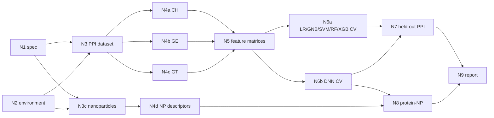

# Stages for reproducing Cha et al. 2022

Paper: M. Cha, E. S. Turali Emre, X. Xiao, J.-Y. Kim, P. Bogdan, J. S. VanEpps, A. Violi & N. A. Kotov, "Unifying structural descriptors for biological and bioinspired nanoscale complexes", *Nat. Comput. Sci.* 2, 243–252 (2022), [doi:10.1038/s43588-022-00229-w](https://doi.org/10.1038/s43588-022-00229-w).

This folder defines the first reproduction test that Italo asked for (email of Nov 6, 2026): the task brief the manager reads, the artifact contracts every stage writes to, the reference task graph, and the in-loop acceptance checks. The gold targets used for scoring live in `mathbac/eval/gold/cha2022/` and are never mounted into the agents' sandbox.

## Stage graph



N1 and N2 run in parallel, as do N3 and N3c, the three descriptor families N4a–N4c with N4d, and the two cross-validation stages.

| Stage | Role | Produces | In-loop check | Checkpoint (weight) |
|---|---|---|---|---|
| N1 Method spec | spec_reader | `spec/spec.yaml`: 19 required keys, each with value, source and status | `spec_contract` | C1 (10) |
| N2 Environment | env_engineer | `env/smoke_report.json` | `env_contract` | C0 (5) |
| N3 PPI dataset | data_curator | pair list (train + held-out), Cα files, distance matrices, counts | `dataset_contract` | C2 (10) |
| N3c Nanoparticles | data_curator | coarse-grained GQD, spherical C, SWNT, 17 Å CNT, ZnO pyramid; case list | `np_contract` | feeds C6 |
| N4a CH descriptors | descriptor_engineer | `features/CH/*.csv` | `features_contract` | C3 (20, shared) |
| N4b GE descriptors | descriptor_engineer | `features/GE/*.csv` (GHECOM + OPD at 5/7/10/15) | `features_contract` | C3 |
| N4c GT descriptors | descriptor_engineer | `features/GT/*.csv` (ORC, FRC, GNM, MFD + 4) | `features_contract` | C3 |
| N4d NP descriptors | descriptor_engineer | `features/np/*.csv` | `np_features_contract` | feeds C6 |
| N5 Feature matrices | ml_engineer | `ml/datasets/<subset>.npz` for 7 subsets, balanced | `ml_dataset_contract` | feeds C4 |
| N6a Classical CV | ml_engineer | raw fold predictions for LR, GNB, SVM, RF, XGB × 7 subsets | `cv_contract` | C4 (25, shared) |
| N6b DNN CV | ml_engineer | raw fold predictions for DNN × 7 subsets; saved models | `cv_contract` | C4 |
| N7 Held-out PPI | ml_engineer | pair probabilities and top-0.1% interfaces for 6WZO, 6NQN, 1C29 | `ppi_pred_contract` | C5 (15) |
| N8 Protein–NP | ml_engineer | interfaces for each NP case; corona ranking | `pni_pred_contract` | C6 (15) |
| N9 Report | reporter | `report/report.md`, `report/claims.yaml`, tool-card drafts | `report_contract` | C7 (rubric) |

The **in-loop check** only tests the contract: files exist, columns are present, rows line up across files, labels are binary, probabilities are in [0, 1]. It never compares against the paper's numbers, so agents cannot tune to it. The **checkpoint** is scored after the run by `mathbac eval`, from the files alone.

## What each checkpoint measures

| ID | Measured from | Target | Pass |
|---|---|---|---|
| C0 | `env/smoke_report.json` | every tier-1 tool's smoke test passes | all ok (self-reported; rerun in the image to confirm) |
| C1 | `spec/spec.yaml` vs 22-item gold checklist | paper values (7 Å, 464 pairs, 27,859,297 residue pairs, 3×512 DNN, 10 folds, top 0.1%, 13 C atoms/node, ...) | ≥ 85% of items; code-only items skipped at L1 |
| C2 | pair list and distance matrices, recomputed | 464 training pairs; residue pairs within 1% of 27,859,297; 1MA9 matrix within 0.01 Å of RCSB coordinates | all three |
| C3 | feature CSVs vs the authors' per-residue values for 1MA9 chain A (Fig. 1 source data), plus Fig. 2a correlations | Pearson r ≥ 0.99 per descriptor (c_charge, hydrophobicity, mw, rinacc, pocketness, opd_7, orc, gnm, frc); Fig. 2a pairs with \|r\| ≥ 0.3 within ±0.25 | every reference descriptor matches and ≥ 80% of correlations |
| C4 | raw fold predictions, metrics recomputed by the evaluator | Table 1 (verified against the per-fold source data), e.g. DNN GT 0.808 / 0.877 / 0.800 (acc / AUC / F1) | headline cells within ±0.03 and all orderings hold: GT > GE > CH, adding CH moves AUC ≤ 0.03, RF/XGB/DNN > LR/GNB/SVM |
| C5 | pair probabilities, interface recomputed at top 0.1%; ground truth from RCSB (identical to the authors' Fig. 4 ground truth) | per-residue F1 of the authors' own predictions: 0.533 / 0.400 / 0.366 | F1 ≥ authors' F1 − 0.10 on all three |
| C6 | NP interface files and corona ranking | hMPO: Arg294 and Tyr313 (in the authors' prediction); PSM-α: residues 11–22 (the authors' predicted region); albumin lowest on SWNT; spherical C below SWNT; GQD–hIAPP and ZnO–β-gal by review | ≥ 5 of 6 |
| C7 | report + claim verdicts | AutoMat-style rubric: fidelity, execution, accuracy, completeness, rigor (1–5) | scored by a reviewer or `mathbac judge` |

Reproduction score = Σ weight × checkpoint score over C0–C6, out of 100. C7 is reported next to it.

## Access levels

| Level | `/materials` contains | What changes for the stages |
|---|---|---|
| L1 | `paper/`, `si/` | N1 works from text alone. N3c must build NP models from the paper's description (the authors used BIOVIA Materials Studio). Code-only checklist items are not scored. |
| L2 | + `code/` (Code Ocean capsule, unified_fast) | N1 can read parameters from code and record paper/code conflicts. Tools still run on agent-built inputs. |
| L3 | + `precomputed/` (capsule's `processed_data_training`, `pdb_np`, GHECOM outputs) | Stages can check themselves against released intermediates. Use L3 to debug the harness, then score L2 and L1. |

Put the materials under `materials/cha2022/<folder>/` (not committed). The paper PDF Qiaoan shared goes in `paper/`; the SI in `si/`.

## Known discrepancies (verified against the released code and the source data)

A good spec (N1) should flag these as `conflict` or `code_only`. Each was checked, not inferred:

- **GNM modes.** The Methods say "the first tenth of the modes"; the code uses the first 10 modes. The code is what produced the paper: the released GNM function reproduces Fig. 1's GNM values for 1MA9 chain A exactly.
- **Fig. 1 labels.** Fig. 1's "OPD" column is the N = 7 index (exact match), and its "MFD" column (panel 1n, "multifractal dimension") is Forman–Ricci curvature (exact match on all 442 residues).
- **Fig. 3c source data.** The DNN "GT" and "GE+CH" rows are swapped relative to Table 1 and the text; Table 1 matches the text and is used as gold. All other 120 Table 1 cells match the per-fold source data in mean and s.d.
- **Held-out scoring (SI Tables 4–6).** The evaluator's 7 Å ground truth is identical to the authors' published ground truth for 6WZO, 6NQN and 1C29, but the SI's accuracy/precision/recall cannot be the per-residue scores of the authors' published predictions (those give F1 0.53 / 0.40 / 0.37). The SI metric is likely pair-level on a resampled test set that is not published.
- **hMPO residues.** The text names Tyr293, Tyr313, Arg294 and Arg307; the authors' Fig. 5d/e prediction (MPO numbering over 1CXP chains A and C) contains Arg294 and Tyr313 but not Tyr293 or Arg307.
- **PSM-α.** The text cites PDB 5KHB and says the GQD docks "near the N-terminus"; the source data use 5I55, and the published prediction covers residues 11–21 of 2–22 (the C-terminal half).
- **NP representation.** The text describes 13-atom coarse-grained NP nodes with 7 Å edges; the released PNI code and the published NP files use one node per atom with 4 Å edges (NP indices in Fig. 5 are atom indices).
- **OPD sizes.** Training features use N = 5, 7, 10, 15 (64 features for "all"); the vectorized `unified_fast` pipeline computes only 5 and 7, and the NP code only 5 and 7.
- **DNN training.** `DNN_train.py` keeps each fold's best epoch by accuracy on that fold's test split, uses `from_logits=True` on a softmax output, fits MinMax scaling on all rows before splitting, and reloads a fixed `best_model` path. `PPI_ML_prediction.py` then applies the fold models to unscaled features.
- **Labels and balance.** Class 0 is the contact class in the released arrays; the training arrays are undersampled (`binary_under_*`), which the paper does not say.
- **Missing pieces.** `PPI_descriptors_cal.py` imports a `descriptor_calc` package that is not in the repository and needs PyMOL; the CH tables (`amino_acid_charge.csv`, `amino_acid_atom_count.csv`) and the 464-pair list are only in the Code Ocean capsule.

## Reference runs

Two direct runs (one Claude agent acting as every worker role; stage scripts and results in
`reference_runs/cha2022/`). DNN at 100 epochs per fold, not 1000.

| Checkpoint (weight) | L3, capsule data | L2, substitute data |
|---|---|---|
| C0 environment (5) | 0.62: GHECOM needs registration; the unified scripts need PyMOL (no Python 3.8 wheel) and a missing package | 0.62 |
| C1 spec (10) | 1.00 | 1.00 |
| C2 data (10) | 0.33: 385 usable pairs of the capsule's 389 (paper: 464) | 0.33: 200 RCSB heterodimers |
| C3 descriptors (20) | 0.97: all 20 reference columns r = 1.000; 18/21 Fig. 2a correlations | 0.71: 14/20 columns (GHECOM approximation r 0.22–0.96); 16/21 correlations |
| C4 Table 1 (25) | 0.88: 96/126 cells | 0.78: 97/126 cells |
| C5 held-out (15) | 0.00: F1 0.21 / 0.16 / 0.18 | 0.33: F1 0.15 / 0.13 / 0.27 |
| C6 protein-NP (15) | 0.50: PSM-α region and both corona trends; hMPO residues missed | 0.00: no corona models at L2 |
| **Score** | **65.4** | **55.3** |

On independent data (L2) the paper's descriptor ranking (GT > GE > CH) and the tree/DNN-over-linear gap hold. The
near-chance linear models are a scaling artifact on both data sets: without scaling, LR falls to AUC 0.565 on every
subset containing GE (paper: 0.56) and SVM to 0.656 (paper: 0.65); with per-fold MinMax scaling LR reaches 0.81.

Interface files follow the top 0.1% of pairs with every pair tied at the cut included. A saturated DNN written with
six decimals gives many pairs a probability of exactly 1; the N7 acceptance check now rejects that, and DNN scores
are computed as 1 − mean P(non-contact) in float64.

## Running stages

```bash
mathbac run --access-level L3 --plan-mode reference --eval          # whole reference graph
mathbac run --only N1,N2                                             # just the first two stages
mathbac run --plan-mode llm --role-mode dynamic                      # manager plans and writes roles (E2)
mathbac eval runs/<run_id>                                           # rescore a finished run
```

To test a later stage on its own, copy reference artifacts for its inputs into a run's workspace, list the producing nodes under `injected_nodes` in the run config, and run with `--only`. The evaluator marks checkpoints that depend on injected nodes as assisted.

## Still open

- The exact 464-pair training list is only in the Code Ocean capsule, which blocks this container's network.
- GHECOM's source download needs a registration form (name, email, affiliation) at pdbj.org/ghecom.
- The GQD–hIAPP and ZnO–β-galactosidase findings need a reviewer; the corona ranking needs NP models the paper does not publish.
