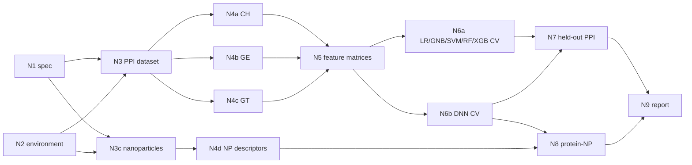

# Stages for reproducing Cha et al. 2022

Paper: M. Cha, E. S. Turali Emre, X. Xiao, J.-Y. Kim, P. Bogdan, J. S. VanEpps, A. Violi & N. A. Kotov, "Unifying structural descriptors for biological and bioinspired nanoscale complexes", *Nat. Comput. Sci.* 2, 243–252 (2022), [doi:10.1038/s43588-022-00229-w](https://doi.org/10.1038/s43588-022-00229-w).

This folder defines the first reproduction test that Italo asked for (email of Nov 6, 2026): the task brief the manager reads, the artifact contracts every stage writes to, the reference task graph, and the in-loop acceptance checks. The gold targets used for scoring live in `mathbac/eval/gold/cha2022/` and are never mounted into the agents' sandbox.

## Stage graph



N1 and N2 run in parallel, as do N3 and N3c, the three descriptor families N4a–N4c with N4d, and the two cross-validation stages.

| Stage | Role | Produces | In-loop check | Checkpoint (weight) |
|---|---|---|---|---|
| N1 Method spec | spec_reader | `spec/spec.yaml`: 19 required keys, each with value, source and status | `spec_contract` | C1 (10) |
| N2 Environment | env_engineer | `env/smoke_report.json` | `env_contract` | C0 (5) |
| N3 PPI dataset | data_curator | pair list (train + held-out), Cα files, distance matrices, counts | `dataset_contract` | C2 (10) |
| N3c Nanoparticles | data_curator | coarse-grained GQD, spherical C, SWNT, 17 Å CNT, ZnO pyramid; case list | `np_contract` | feeds C6 |
| N4a CH descriptors | descriptor_engineer | `features/CH/*.csv` | `features_contract` | C3 (20, shared) |
| N4b GE descriptors | descriptor_engineer | `features/GE/*.csv` (GHECOM + OPD at 5/7/10/15) | `features_contract` | C3 |
| N4c GT descriptors | descriptor_engineer | `features/GT/*.csv` (ORC, FRC, GNM, MFD + 4) | `features_contract` | C3 |
| N4d NP descriptors | descriptor_engineer | `features/np/*.csv` | `np_features_contract` | feeds C6 |
| N5 Feature matrices | ml_engineer | `ml/datasets/<subset>.npz` for 7 subsets, balanced | `ml_dataset_contract` | feeds C4 |
| N6a Classical CV | ml_engineer | raw fold predictions for LR, GNB, SVM, RF, XGB × 7 subsets | `cv_contract` | C4 (25, shared) |
| N6b DNN CV | ml_engineer | raw fold predictions for DNN × 7 subsets; saved models | `cv_contract` | C4 |
| N7 Held-out PPI | ml_engineer | pair probabilities and top-0.1% interfaces for 6WZO, 6NQN, 1C29 | `ppi_pred_contract` | C5 (15) |
| N8 Protein–NP | ml_engineer | interfaces for each NP case; corona ranking | `pni_pred_contract` | C6 (15) |
| N9 Report | reporter | `report/report.md`, `report/claims.yaml`, tool-card drafts | `report_contract` | C7 (rubric) |

The **in-loop check** only tests the contract: files exist, columns are present, rows line up across files, labels are binary, probabilities are in [0, 1]. It never compares against the paper's numbers, so agents cannot tune to it. The **checkpoint** is scored after the run by `mathbac eval`, from the files alone.

## What each checkpoint measures

| ID | Measured from | Target | Pass |
|---|---|---|---|
| C0 | `env/smoke_report.json` | every tier-1 tool's smoke test passes | all ok (self-reported; rerun in the image to confirm) |
| C1 | `spec/spec.yaml` vs 22-item gold checklist | paper values (7 Å, 464 pairs, 27,859,297 residue pairs, 3×512 DNN, 10 folds, top 0.1%, 13 C atoms/node, ...) | ≥ 85% of items; code-only items skipped at L1 |
| C2 | pair list and distance matrices, recomputed | 464 training pairs; residue pairs within 1% of 27,859,297; 1MA9 matrix within 0.01 Å of RCSB coordinates | all three |
| C3 | feature CSVs vs reference descriptors from the released code | Pearson r ≥ 0.99 per descriptor on reference chains (6WZO A/B, 1MA9 A/B); Fig. 2a correlations (ORC~FRC, Shell~R<sub>inacc</sub>) | every descriptor matches |
| C4 | raw fold predictions, metrics recomputed by the evaluator | Table 1, e.g. DNN GT 0.808 / 0.877 / 0.800 (acc / AUC / F1) | headline cells within ±0.03 and all orderings hold: GT > GE > CH, adding CH moves AUC ≤ 0.03, RF/XGB/DNN > LR/GNB/SVM |
| C5 | pair probabilities, interface recomputed at top 0.1%; ground truth from RCSB | ~80% residue accuracy on 6WZO, 6NQN, 1C29 | ≥ 0.75 on all three |
| C6 | NP interface files and corona ranking | CNT–hMPO hits Tyr293/Tyr313/Arg294/Arg307; GQD–PSM-α near the N-terminus; albumin ranks lowest on SWNT; spherical C below SWNT; GQD–hIAPP and ZnO–β-gal by review | ≥ 5 of 6 |
| C7 | report + claim verdicts | AutoMat-style rubric: fidelity, execution, accuracy, completeness, rigor (1–5) | scored by a reviewer or `mathbac judge` |

Reproduction score = Σ weight × checkpoint score over C0–C6, out of 100. C7 is reported next to it.

## Access levels

| Level | `/materials` contains | What changes for the stages |
|---|---|---|
| L1 | `paper/`, `si/` | N1 works from text alone. N3c must build NP models from the paper's description (the authors used BIOVIA Materials Studio). Code-only checklist items are not scored. |
| L2 | + `code/` (Code Ocean capsule, unified_fast) | N1 can read parameters from code and record paper/code conflicts. Tools still run on agent-built inputs. |
| L3 | + `precomputed/` (capsule's `processed_data_training`, `pdb_np`, GHECOM outputs) | Stages can check themselves against released intermediates. Use L3 to debug the harness, then score L2 and L1. |

Put the materials under `materials/cha2022/<folder>/` (not committed). The paper PDF Qiaoan shared goes in `paper/`; the SI in `si/`.

## Known discrepancies the agents should find

These are written into the stage facts and tool cards, and a good spec (N1) should flag them as `conflict` or `code_only`:

- **GNM modes.** The Methods say "the square sum of the first tenth of the modes". The released code calls `GNM.gnm_sum_mode(pdb, 10, chain)`: the first 10 modes.
- **OPD sizes.** Training features in the original capsule use neighbourhood sizes 5, 7, 10 and 15 (64 features for "all"). The vectorized `unified_fast` pipeline computes only 5 and 7.
- **DNN model selection.** `DNN_train.py` keeps each fold's best epoch by accuracy on that fold's test split, uses `from_logits=True` on a softmax output, fits MinMax scaling on all rows before splitting, and reloads a fixed `best_model` path rather than the fold checkpoint. The `dnn_train` tool reproduces the first three by default and offers switches for the unbiased variant.
- **Labels.** In the released arrays class 0 is the contact class (`pos_label=0`); our contracts use 1 = contact.
- **Missing module.** `PPI_descriptors_cal.py` imports `descriptor_calc`, which is not in the repository; the tool wrapper maps it to `unified_descriptors/`.
- **Class balance.** The training arrays are named `binary_under_*`: non-contacts were undersampled. The paper text does not say this.

## Running stages

```bash
mathbac run --access-level L3 --plan-mode reference --eval          # whole reference graph
mathbac run --only N1,N2                                             # just the first two stages
mathbac run --plan-mode llm --role-mode dynamic                      # manager plans and writes roles (E2)
mathbac eval runs/<run_id>                                           # rescore a finished run
```

To test a later stage on its own, copy reference artifacts for its inputs into a run's workspace, list the producing nodes under `injected_nodes` in the run config, and run with `--only`. The evaluator marks checkpoints that depend on injected nodes as assisted.

## Still open

- `scripts/make_reference_descriptors.py` covers the curvature, MFD and OPD columns. GNM, GHECOM and CH columns still need mapping from the released pipeline's matrix before C3 can be scored on every descriptor.
- The C5 scoring rule (per-residue accuracy over each chain) follows the released code's output; confirm it against SI Tables 4–6.
- The GQD–PSM-α rule in C6 ("most predicted residues in the N-terminal third") is provisional; check it against Fig. 5a.
- The GHECOM wrapper's flags follow its residue-output mode and are checked by the smoke test; confirm on the first image build.
